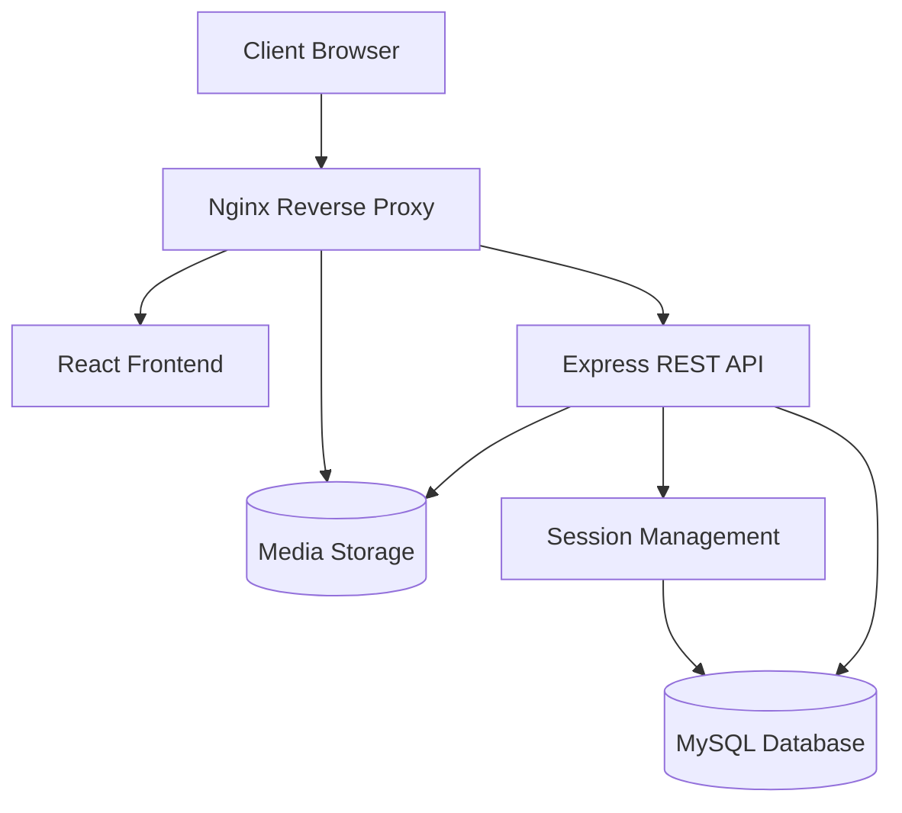

# CODE STACK

> **Beyond the Code, Build Your Future.**
>
> 코드를 넘어, 새로운 가능성을 쌓아가다.


---

## 📖 About Project

**CODE STACK**은 개발자를 꿈꾸는 학습자들을 위한 온라인 동영상 강의 플랫폼입니다.

기존 온라인 교육 플랫폼의 기능을 바탕으로, 차별화된 인터랙티브 디자인과 직관적인 사용자 경험을 결합하여 보다 몰입감 있는 학습 환경을 제공하는 것을 목표로 합니다.

수강생은 다양한 프로그래밍 강좌를 탐색하고, 동영상 강의를 시청하며, 강의 자료 다운로드 및 질문과 답변 기능을 통해 학습할 수 있습니다.

관리자는 강좌 개설부터 주차별 콘텐츠 등록, 수강생 정보 조회, 수강평 관리까지 교육 서비스 운영에 필요한 기능을 관리할 수 있습니다.

---

## ✨ Key Features

### Interactive Landing Page

- 그리스·로마 신화풍 비주얼을 활용한 브랜드 디자인
- 스크롤 기반 인터랙티브 모션
- 브랜드 슬로건과 시각적 스토리텔링
- 현대적인 타이포그래피와 UI 디자인

### Learning Experience

- 강좌 목록 및 상세 정보 조회
- 주차별 커리큘럼 제공
- 16:9 비율의 동영상 플레이어
- 이전 강의 및 다음 강의 이동
- 영상 재생 위치 저장 및 이어보기
- 강의 자료 다운로드
- 강의별 질문 및 답변
- 강좌 수강평 및 별점 등록
- 개인 수강 강좌 관리

### Admin Management

- 관리자 전용 관리 화면
- 강좌 등록, 수정 및 삭제
- 주차별 강의 콘텐츠 관리
- 동영상 및 강의 자료 업로드
- 기존 강의 파일 교체
- 회원 및 수강 신청 정보 조회
- 수강생 질문 조회 및 답변
- 수강평 조회 및 삭제
- 메인 페이지 팝업 관리

### Authentication

- 회원가입 및 로그인
- 세션 기반 사용자 인증
- 관리자 및 수강생 권한 분리
- 비밀번호 해싱을 통한 계정 정보 보호
- 이메일 및 전화번호 중복 검사
- 비밀번호 유효성 검사

---

## 🛠 Tech Stack

| Category | Technology |
|---|---|
| Frontend | React 19, JavaScript, CSS |
| Build Tool | Vite 6 |
| Backend | Node.js, Express.js |
| Database | MySQL 8.4 |
| Authentication | Express Session, MySQL Session Store |
| File Upload | Multer |
| Web Server | Nginx |
| Infrastructure | Docker, Docker Compose |
| Version Control | Git, GitHub |

---

## 🏗 System Architecture



CODE STACK은 프론트엔드와 백엔드를 분리한 웹 애플리케이션 구조로 설계되었습니다.

Nginx를 통해 클라이언트 요청을 처리하고, Express 기반 REST API를 통해 데이터베이스와 통신합니다. 동영상 및 강의 자료는 Docker Volume을 활용하여 저장하며, Docker Compose를 통해 전체 서비스를 통합 관리합니다.

---

## 📂 Project Structure

```text
code-stack/
├── client/
│   ├── public/
│   │   └── goddess.png
│   ├── src/
│   │   ├── main.jsx
│   │   └── style.css
│   ├── index.html
│   └── package.json
│
├── server/
│   ├── index.js
│   ├── package.json
│   └── Dockerfile
│
├── nginx/
│   ├── default.conf
│   └── Dockerfile
│
├── compose.yaml
└── README.md
```

---

## 🗄 Database Design

| Table | Description |
|---|---|
| users | 사용자 계정 및 권한 정보 |
| courses | 강좌 기본 정보 |
| lessons | 주차별 강의 및 콘텐츠 정보 |
| enrollments | 사용자별 수강 신청 정보 |
| progress | 사용자별 영상 재생 위치 |
| reviews | 강좌별 수강평 및 별점 |
| questions | 강의별 질문 및 답변 |
| popup | 메인 페이지 팝업 정보 |
| app_flags | 초기 데이터 생성 상태 관리 |

---

## 🔗 REST API

| Method | Endpoint | Description |
|---|---|---|
| POST | /api/register | 회원가입 |
| POST | /api/login | 로그인 |
| POST | /api/logout | 로그아웃 |
| GET | /api/me | 로그인 사용자 정보 조회 |
| GET | /api/courses | 전체 강좌 조회 |
| GET | /api/courses/:id | 강좌 상세 조회 |
| POST | /api/courses | 강좌 등록 |
| PUT | /api/courses/:id | 강좌 수정 |
| DELETE | /api/courses/:id | 강좌 삭제 |
| POST | /api/courses/:id/enroll | 수강 신청 |
| GET | /api/mine | 내 수강 강좌 조회 |
| GET | /api/lessons/:id | 강의 상세 조회 |
| POST | /api/courses/:id/lessons | 강의 콘텐츠 등록 |
| POST | /api/lessons/:id/progress | 영상 재생 위치 저장 |
| POST | /api/lessons/:id/questions | 질문 등록 |
| POST | /api/questions/:id/answer | 질문 답변 |
| POST | /api/courses/:id/review | 수강평 등록 |
| GET | /api/admin/overview | 관리자 운영 정보 조회 |

---

## 🚀 Getting Started

### Prerequisites

프로젝트 실행을 위해 다음 프로그램이 필요합니다.

- Git
- Docker
- Docker Compose

### 1. Clone Repository

```bash
git clone https://github.com/YOUR_USERNAME/code-stack.git
cd code-stack
```

### 2. Start Docker

macOS 환경에서는 Docker Desktop을 실행합니다.

```bash
open -a Docker
```

### 3. Build & Run

```bash
docker compose up -d --build
```

Docker Compose를 실행하면 MySQL 데이터베이스, Node.js 서버, Nginx 웹 서버가 구성됩니다.

### 4. Access Application

```text
http://localhost:8080
```

### 5. Check Container Status

```bash
docker compose ps
```

### 6. Stop Application

```bash
docker compose down
```

데이터베이스와 업로드된 콘텐츠를 유지하려면 `docker compose down -v` 명령어 사용에 주의해야 합니다.

---

## 👤 Demo Accounts

로컬 테스트 환경에서는 관리자 및 수강생 데모 계정이 자동으로 생성됩니다.

| Role | Description |
|---|---|
| Administrator | 강좌 및 서비스 운영 관리 |
| Student | 강좌 수강 및 학습 기능 이용 |

초기 실행 시 8개의 예시 강좌가 생성되며, 강의 동영상은 관리자 페이지에서 직접 등록할 수 있습니다.

---

## 📁 Supported File Formats

| Type | Format |
|---|---|
| Video | MP4, WEBM |
| Document | PDF, DOCX |
| Presentation | PPTX |
| Spreadsheet | XLSX |
| Archive | ZIP |

---

## 🎨 Design Philosophy

**Immersive. Minimal. Intuitive.**

CODE STACK은 단순히 동영상 강의를 제공하는 플랫폼을 넘어, 사용자에게 차별화된 디지털 학습 경험을 제공하고자 합니다.

인터랙티브 랜딩 페이지를 통해 브랜드의 정체성을 전달하고, 실제 학습 화면에서는 불필요한 요소를 최소화하여 학습에 집중할 수 있도록 설계하였습니다.

- **Immersive** — 몰입감 있는 시각적 경험
- **Minimal** — 불필요한 요소를 제거한 세련된 디자인
- **Intuitive** — 직관적이고 편리한 사용자 인터페이스
- **Scalable** — 지속적인 기능 확장을 고려한 시스템 구조

---

## 📌 Roadmap

### Core Features

- [x] 인터랙티브 랜딩 페이지
- [x] 회원가입 및 로그인
- [x] 강좌 등록 및 조회
- [x] 관리자 전용 기능
- [x] 동영상 강의 플레이어
- [x] 강의 자료 업로드 및 다운로드
- [x] 영상 이어보기
- [x] 질문 및 답변 시스템
- [x] 수강평 시스템
- [x] Docker 기반 실행 환경

### Future Updates

- [ ] 첫 방문 및 재방문 사용자 경험 분리
- [ ] 인트로 건너뛰기 기능
- [ ] 관리자 통계 대시보드 고도화
- [ ] 수강생별 학습 진도율 분석
- [ ] 드래그 앤 드롭 커리큘럼 편집
- [ ] 공지사항 및 알림 시스템
- [ ] 시험 및 퀴즈 시스템
- [ ] 수료증 자동 발급
- [ ] AI 기반 학습 도우미
- [ ] 클라우드 기반 동영상 저장소
- [ ] 프로덕션 서버 배포

---

## 🔒 Security & Deployment

현재 프로젝트는 로컬 개발 및 시연 환경을 기준으로 구성되어 있습니다.

실제 서비스 배포 전에는 다음과 같은 보안 설정이 필요합니다.

- 환경 변수를 통한 민감 정보 관리
- 기본 관리자 계정 및 비밀번호 변경
- 데이터베이스 접속 정보 보호
- HTTPS 적용
- 콘텐츠 접근 권한 강화
- 파일 업로드 보안 검증
- 데이터베이스 및 콘텐츠 백업

---

## 🎯 Project Goal

본 프로젝트는 웹 애플리케이션 개발 전반에 대한 이해를 높이고, 실제 서비스에서 사용되는 프론트엔드, 백엔드, 데이터베이스 및 인프라 기술을 통합적으로 경험하는 것을 목표로 합니다.

지속적인 기능 개선과 사용자 경험 향상을 통해 완성도 높은 온라인 교육 플랫폼으로 발전시키고자 합니다.

---

**CODE STACK**

*Learn. Build. Stack.*

© CODE STACK. All rights reserved.
